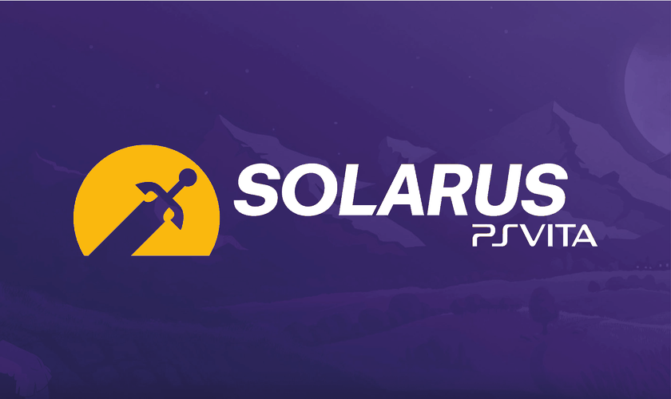
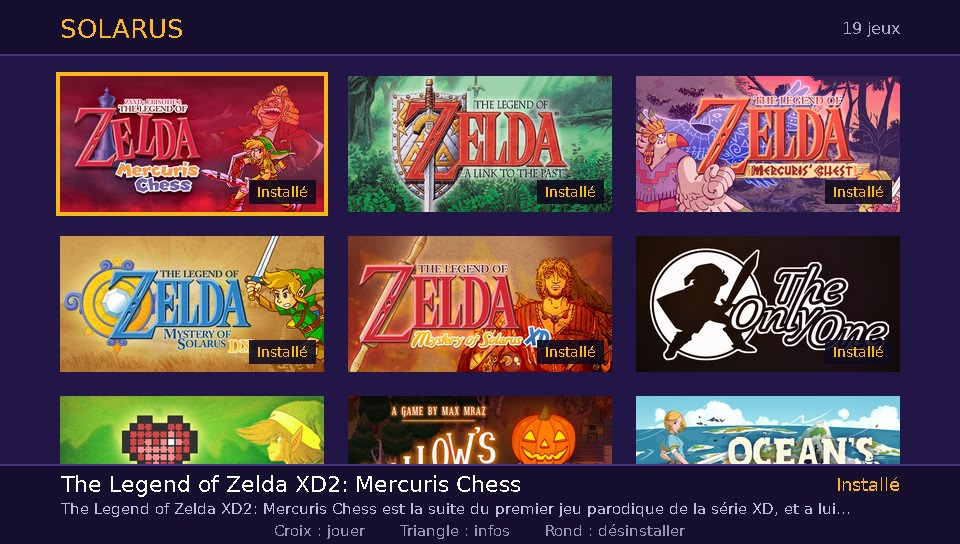
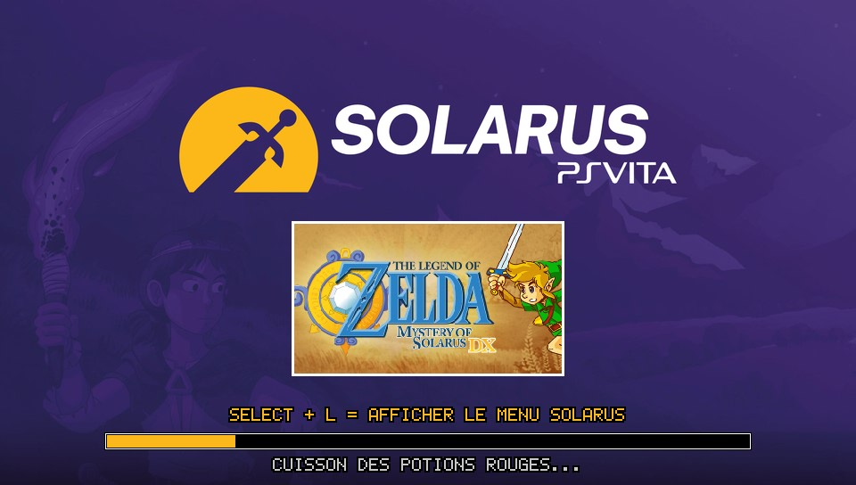
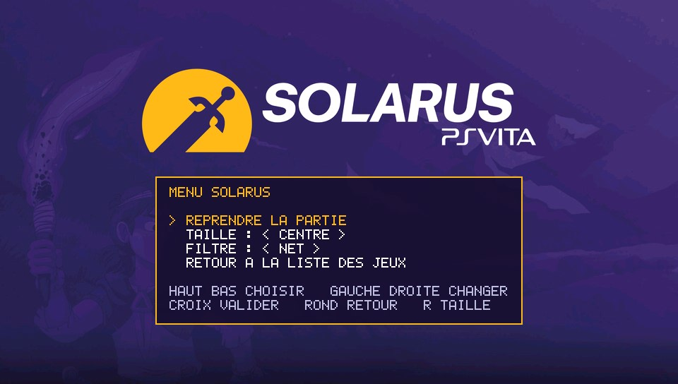

# Solarus Launcher for PS Vita

A port of the [Solarus](https://www.solarus-games.org) 2.0 engine to the PlayStation Vita, with a built-in quest launcher.
Browse the free games published on solarus-games.org, download them and play them directly on your Vita — no PC needed.

## Features

- Solarus engine 2.0.3 running natively on the Vita
- Built-in launcher: game list with pictures and descriptions, downloaded from solarus-games.org
- One-tap download and install of quests (stored in `ux0:data/Solarus/quests/`)
- Delete an installed game from the launcher, with or without its saves
- In-game engine menu (**Select + L**): per-game button remapping, saved for each game
- **R**: toggle stretched / centered display
- Pressing the PS button pauses the game; reopening the app resumes it
- Interface in French or English, following the console language

## Screenshots

| Game list | Loading a game | In-game engine menu (Select + L) |
|---|---|---|
|  |  |  |

## Installation

1. Download `SolarusLauncher.vpk` from the [Releases](../../releases) page.
2. Copy it to your Vita and install it with VitaShell.
3. Launch **Solarus Launcher**, pick a game and press X to download it.

An internet connection is needed to download games. Already downloaded games can be played offline.

## Notes

- Some games are hidden because they are too slow on the Vita for now, or already have a native Vita port (Return of the Hylian SE).
- The `vpk/overrides/` folder contains small Vita-specific adjustments (HUD layout, French translations) applied on top of some quests.

## Building

The port is built with [VitaSDK](https://vitasdk.org) under MSYS2. See [compilation.MSYS2.md](compilation.MSYS2.md) for the toolchain, then build the `solarus-run` target in a `build-vita` folder and package `eboot.bin` with the contents of `vpk/`.

## Credits

- [Solarus](https://gitlab.com/solarus-games/solarus) by Christopho and the Solarus team — the engine and the games.
- PS Vita port and launcher by LAB0ULANGE.

## License

Solarus is free software licensed under the GNU GPL v3 (see [license](license)). This port is distributed under the same license.
The games downloaded by the launcher belong to their respective authors and keep their own licenses.

This project is not affiliated with Nintendo or Sony.
